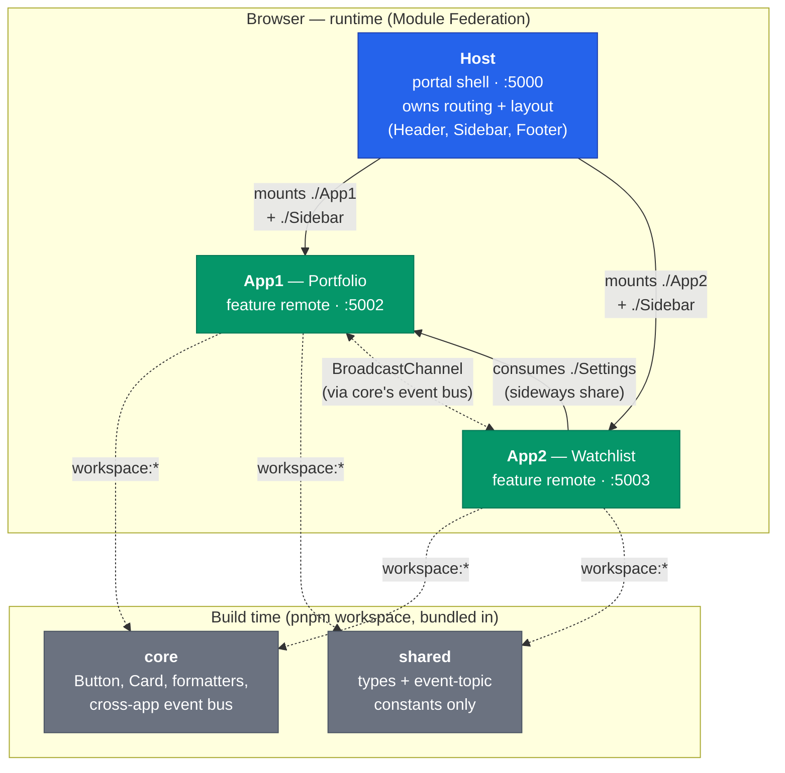

# ui-microfrontend

A production-shaped **Module Federation microfrontend starter kit** for React + Vite + TypeScript. Clone it, delete the example domain (a small "Portfolio"/"Watchlist" trading demo), and build your own apps on scaffolding that already handles the parts that are easy to get wrong: independent team ownership, cross-app sharing without version lock-in, federation that actually works in `dev` mode, and documented tradeoffs for cross-cutting problems (layout injection, app-to-app messaging) every microfrontend project eventually hits.

**This is not a trading app.** App1 ("Portfolio") and App2 ("Watchlist") exist only to demonstrate the patterns — every file that's pure example content is marked `EXAMPLE DOMAIN CONTENT` in a comment at the top, telling you what to keep (the pattern) and what to delete (the trading-specific logic). See [Using this as your own project](#using-this-as-your-own-project) for the concrete steps.

## Architecture at a glance



Solid arrows are **Module Federation** (runtime, loaded over HTTP as `remoteEntry.js` — no rebuild needed to pick up a new deploy). Dashed arrows are **pnpm workspace** dependencies (compiled directly into the consumer's bundle at build time). The dotted double arrow is the **cross-app event bus** (`BroadcastChannel`, not federation or a shared import — see [App-to-app messaging](#app-to-app-messaging-the-cross-app-event-bus)).

Notice Host never touches Core or `shared` — it renders no Core components and needs no cross-app event contracts, so depending on either would be pure dead weight. See [Three integration mechanisms, chosen deliberately](#three-integration-mechanisms-chosen-deliberately) for why each arrow type was chosen over the alternatives.

## What this demonstrates

| Capability | Where |
|---|---|
| Federation that actually works in `dev` mode — live HMR across Host + remotes, not just after a build | [`dev` mode now works for federation](#dev-mode-now-works-for-federation-this-changed-with-the-plugin-swap) |
| Each remote runs fully standalone, with no dependency on Host or any other remote being up | [Getting started](#getting-started) |
| Cross-app type safety — a remote's real TypeScript types, auto-generated, no hand-written `declare module` | [Cross-app types are auto-generated](#cross-app-types-are-auto-generated--no-manual-declare-module-needed) |
| Sideways sharing between two feature apps, bypassing the portal shell (App1 → App2) | [Sharing patterns](#sharing-patterns-core-vs-cross-app-federation) |
| A feature app contributing UI into the shell's layout (Host's Sidebar) without a reverse federation edge | [Cross-boundary layout injection](#cross-boundary-layout-injection-how-a-feature-app-puts-content-into-hosts-chrome) |
| App-to-app messaging that works regardless of which apps are mounted, or even across browser tabs | [App-to-app messaging](#app-to-app-messaging-the-cross-app-event-bus) |
| A deliberate boundary between a runtime component library (Core) and a types-only contract package (`shared`) | [Core vs. `shared`](#core-vs-shared-the-actual-distinction) |
| Graceful degradation — the portal keeps working if a remote is down or not yet deployed | [How the pieces fit together](#how-the-pieces-fit-together) |
| Env-driven remote URLs — point at staging/prod deployments with no code changes | [How the pieces fit together](#how-the-pieces-fit-together) |
| A path to splitting into separate repos with independent CI/CD, with no architectural rework | [Splitting into separate repos](#splitting-into-separate-repos) |

## What's in the box

```
shared/ -> cross-app TypeScript contracts       (pnpm workspace pkg, types + constants only)
core/   -> shared component library + utils     (pnpm workspace pkg, port 5001 for standalone preview)
app1/   -> EXAMPLE feature app ("Portfolio")    (federation remote,  port 5002)
app2/   -> EXAMPLE feature app ("Watchlist")    (federation remote,  port 5003)
host/   -> Portal shell that composes App1/App2 (federation host,    port 5000)
```

Five independent projects, each meant to live in its **own git repo** with its own CI/CD pipeline (or all five in one repo with path-filtered CI — see [Splitting into separate repos](#splitting-into-separate-repos) for the tradeoff). Three different integration mechanisms are used, chosen per what each piece actually is — see [Three integration mechanisms, chosen deliberately](#three-integration-mechanisms-chosen-deliberately).

**Stack:** React 19, Vite 8, TypeScript 5.9, pnpm workspaces, [`@module-federation/vite`](https://github.com/module-federation/vite) for Module Federation.

## Using this as your own project

1. **Rename the project identity.** Replace `ui-microfrontend` in this README's title, `host/index.html`'s `<title>`, `host/src/layout/Header.tsx` and `Footer.tsx`, and each `package.json`'s `name` field (or leave folder/package names as `core`/`app1`/`app2`/`host`/`shared` if generic names suit you — nothing requires renaming them).
2. **Replace App1 and App2 with your own feature apps.** Every file marked `EXAMPLE DOMAIN CONTENT` (grep for that string) is meant to be deleted or rewritten — `PortfolioApp.tsx`, `WatchlistApp.tsx`, `app1/src/domain/Settings/*`, `shared/src/events/portfolio.ts`. The surrounding scaffolding in the same files (the fact that it's a `bootstrap.tsx`-exposed component, that it calls `publish()`, that it's structured as a standalone-renderable app) is what to keep — see the comments at each marker for specifics on what pattern that file demonstrates.
3. **Decide what goes in Core vs. `shared` vs. your apps** using the tests in [Sharing patterns](#sharing-patterns-core-vs-cross-app-federation) and [Core vs. `shared`](#core-vs-shared-the-actual-distinction) — this is the part most worth reading before writing new code, since getting this boundary wrong is the most common regret in a real microfrontend project.
4. **Add more feature apps** following [Adding a new microfrontend app](#adding-a-new-microfrontend-app-app3-etc) — the pattern scales to as many as you need.
5. **When you're ready to split into separate repos** (per-team ownership, independent CI/CD, independent release cadence), follow [Splitting into separate repos](#splitting-into-separate-repos) — the workspace was built from the start so this requires no architectural changes, only swapping `workspace:*` for published versions.

Everything below this point documents the architecture, the reasoning behind each decision, and the dead ends already tried and rolled back — read it before re-deciding something it already covers.

## pnpm workspace: dev convenience, not a merged deploy story

The root `pnpm-workspace.yaml` + single `pnpm-lock.yaml` exist so a contributor can run **one** `pnpm install` instead of five, and so App1/App2 link Core and `shared` via `workspace:*` instead of hand-maintained `file:../core` paths. That's the entire scope of what it does:

- Each app still has its own `package.json`, its own scripts, its own build output, and builds/typechecks correctly standalone from inside its own folder (`cd app1 && pnpm build` works with no awareness of the other four).
- There is **no root-level build/test/lint script** that operates across all five — deliberately. Adding one would start to imply "these five ship together," which contradicts each team owning its own repo and CI/CD.
- When a folder splits into its own repo, it drops out of `pnpm-workspace.yaml` and its `workspace:*` dependency becomes a real published version — that's the only code change the split requires (see below).

## Three integration mechanisms, chosen deliberately

**Core is a library, linked via the pnpm workspace** (`workspace:*`), not a runtime remote. App1 and App2 each declare `"core": "workspace:*"` — pnpm resolves that to a symlink into `core/` today, and to a real semver range once Core is split into its own repo and published.

- Each app's team controls exactly when they upgrade Core — no shared-runtime version to keep in sync across teams.
- Core's code (tiny: a couple of components + formatters + the event bus) gets duplicated into App1's and App2's bundles. That's an acceptable, deliberate tradeoff for something this small and library-shaped.
- The cost: a Core bugfix doesn't apply everywhere until each consumer bumps and redeploys. If Core ships fast-moving fixes, weigh that against the version-independence benefit.

**`shared` is a types-only library**, also linked via the pnpm workspace, but distinct from Core in an important way: it ships **zero runtime bytes**. Everything it exports is either `export type` (erased entirely at compile time) or a small constant (a string topic name) with no behavior attached. See [Core vs. `shared`, the actual distinction](#core-vs-shared-the-actual-distinction) below for why this split exists and what goes where.

**App1 and App2 are Module Federation remotes** (via [`@module-federation/vite`](https://github.com/module-federation/vite), the official, actively-maintained Vite federation plugin from the Module Federation Core Team), consumed by Host at runtime.

> **Note on plugin choice:** this originally used `@originjs/vite-plugin-federation`. That plugin is now unmaintained — confirmed broken on Vite 7+ (see [issue #732](https://github.com/originjs/vite-plugin-federation/issues/732)), and even the Module Federation Core Team asked its maintainers how to deprecate it in favor of their own package ([issue #748](https://github.com/originjs/vite-plugin-federation/issues/748)). This repo migrated to `@module-federation/vite` as part of the Vite 8 upgrade — do not add `@originjs/vite-plugin-federation` back.

- Host never bundles App1/App2 source — it loads their already-built (or, now, dev-server-served — see below) `remoteEntry.js` over HTTP at runtime, so a new App1 deploy shows up in the portal without rebuilding Host.
- `react`, `react-dom`, `react-router-dom` are shared/deduped (`shared: { react: { singleton: true }, ... }`) across Host + whichever remotes are mounted, so there's one React instance/tree at runtime regardless of which features are loaded.
- This only makes sense for whole runtime features (a page, a section) that would be wasteful to duplicate into Host's bundle and that need to be swappable without a Host rebuild — which is exactly App1/App2's role, and not Core's.

## `dev` mode now works for federation (this changed with the plugin swap)

With the old `@originjs/vite-plugin-federation`, remotes only worked when built + previewed — `vite dev` silently served the SPA fallback instead of a real `remoteEntry.js` (HTTP 200, wrong content, no error). **`@module-federation/vite` fixes this**: running `pnpm dev` in App1, App2, and Host simultaneously gives full HMR *and* working live federation across all three — Host correctly loads App1/App2's dev-server-served remotes, and App2 correctly loads App1's `Settings` remote the same way. Verified directly by fetching each dev server's `/remoteEntry.js` and confirming the consumer's transformed source resolves `import('app1/Settings')` to a real virtual module fetching from App1's live dev server.

Practical effect: no more build+preview+refresh cycle for day-to-day cross-app development — see [Run all apps together](#run-all-apps-together-live-with-hmr-recommended) below. `preview` (of a real `pnpm build`) still matters as a realistic pre-deploy check, just not for daily iteration.

## Sharing patterns: Core vs. cross-app federation

There are two different ways for one app's code to end up used by another, and which one applies depends on what's actually being shared:

| | **Core (workspace/npm package)** | **Cross-app federation** (e.g. App1 → App2) |
|---|---|---|
| What it's for | Generic, reusable UI primitives and utils with no domain knowledge (`Button`, `Card`, `formatCurrency`) | A whole feature or domain-specific component that only makes sense in the context of the app that owns it |
| Example here | `Button`, `Card`, formatters | `app1/Settings` — a risk-preference panel that encodes App1's own domain rules (risk tiers, rebalance thresholds) |
| Contract | Compile-time: TypeScript catches a breaking change at install + build time | Runtime, but with real cross-app type-checking now — see below |
| Who decides when to upgrade | Each consumer, independently, whenever they bump the dependency | Whoever's running App2 gets whatever App1 has deployed right now, unless App2 pins a specific `remoteEntry.js` URL/version |
| Ownership | Core's team owns the API, versions it, consumers pull when ready | App1's team now has an implicit contract with every consumer of that expose — check `consumedBy` in `federation.manifest.ts` before changing props |

**Rule of thumb:** if a component would make sense with all business/domain knowledge stripped out, it belongs in Core. If stripping the domain knowledge out would leave nothing useful, keep it in the owning app and expose it sideways via federation — same mechanism App1 already uses to expose itself to Host, just consumed by a sibling app instead of the portal.

**Example in this repo:** App1 exposes `./Settings` (`app1/src/domain/Settings/`) — a risk-preference panel — which App2 consumes directly (`app2/src/WatchlistApp.tsx`), without going through Host. App1's own `PortfolioApp` also renders the same component, so it's genuinely shared, not just theoretically exposed. This is a **sideways** federation relationship (App1 → App2), separate from the **upward** one both apps have with Host — a consumer can be another feature app, not just the portal shell.

### Cross-app types are auto-generated — no manual `declare module` needed

`@module-federation/vite` bundles a DTS plugin that extracts each remote's *real* TypeScript types from source and writes them into the consumer's `@mf-types/<remoteName>/` folder on dev-server start or build (e.g. `app2/@mf-types/app1/Settings.d.ts`, re-exporting App1's actual `SettingsPanelProps`/`RiskProfile`). Each consumer's `tsconfig.json` maps the import path to that folder:

```json
"paths": { "app1/*": ["./@mf-types/app1/*"] },
"include": ["src", "@mf-types"]
```

This replaces what used to be a hand-written `declare module 'app1/Settings' { ... }` block in `src/remotes.d.ts` — which was a real liability, since nothing enforced it staying in sync with App1's actual props. Now a breaking prop change in App1's `SettingsPanel` shows up as a real `tsc` error in App2, not just a runtime surprise. `@mf-types/` is generated (gitignored, like `dist/`) — never hand-edit it.

### Keeping the expose/remote lists manageable

Once more than one thing crosses a federation boundary, hand-editing `exposes`/`remotes` objects inline in `vite.config.ts` gets hard to track — you end up hunting across files to answer "what does App1 expose, and who's consuming it?" This repo centralizes that into two small files per app:

- **`federation.manifest.ts`** (in every remote — Core doesn't need one since it's not a remote): the list of everything that app exposes, each entry typed with a `path`, `entry`, `consumedBy` (who breaks if you change it), and `note` (why it's exposed instead of living in Core). `vite.config.ts` just calls `toFederationExposesRecord()` — it never lists exposes inline.
- **`federation.remotes.ts`** (in every consumer — App2 and Host both have one, since App2 now consumes App1): the list of remotes that app pulls in, each with its env var and local-dev fallback URL, reduced to `@module-federation/vite`'s `{ type: 'module', name, entry }` shape via `toFederationRemotesRecord(env)`. `vite.config.ts` never has inline URL strings.

Adding a new cross-app share means: add one entry to the exposing app's `federation.manifest.ts`, one entry to the consuming app's `federation.remotes.ts`, and a `paths` entry in the consumer's `tsconfig.json` (types then resolve automatically — no manual declarations). `vite.config.ts` itself never needs touching again.

## Layout ownership: Host, not Core, and not any one feature app

Header, sidebar, footer — the portal's page chrome — belongs to **Host**, not Core and not App1/App2:

- It isn't a reusable UI primitive like `Button` (Core's job) — it's a structural decision about the page as a whole, and only the portal can see the whole page.
- It isn't any one feature app's job either — if App1 owned the header, App2 (and any future App3) would have no say in it. Only the thing that composes all the apps together can neutrally own the shell they all sit inside.

Core could still supply the *visual* building blocks a header/sidebar are built from (a styled `<HeaderBar>` primitive, spacing tokens) if that need arises — that's Core-shaped (generic, no domain knowledge). The *decision* of what the shell looks like and which regions exist is Host's.

`host/src/layout/` holds this: `AppShell.tsx` composes `Header` + `Sidebar` + routed content + `Footer`.

### Cross-boundary layout injection: how a feature app puts content into Host's chrome

A feature app sometimes legitimately wants to contribute something to the shared chrome — Sidebar's second-level nav being the example built out in this repo. Two shapes were tried and rejected before landing on the one below: a Host-owned slot registry consumed by App1 (creates a new App1→Host federation edge, inverting the normal stability direction — shells should be stable, features volatile), and a shared `React.Context` in Core (doesn't work — Core isn't in any app's federation `shared` config, so each app bundles its own separate copy, and `createContext()` produces unrelated objects per bundle).

**What works:** each app exposes a `./Sidebar` component via Module Federation — `app1/src/Sidebar.tsx`, `app2/src/Sidebar.tsx` — the same way App1 already exposes `./App1` (its main page) and `./Settings` (a sideways share to App2). No new federation edge: it's the same Host→App1/App2 edge already used to mount each app's main page, just one more exposed path on it. Host never sees or interprets app-shaped data — `host/src/layout/useActiveRemoteSidebar.ts` matches the current URL against each remote's `routePrefix` (`host/federation.remotes.ts`) to decide *whether* to mount a component, and `host/src/layout/Sidebar.tsx` wraps whatever comes back in the same `RemoteBoundary` pattern used for the main page mounts — it contains zero app-specific code. Each app owns its own links, styling, and any future logic (active-item highlighting, badges) outright. Adding a new remote's sidebar is a `federation.remotes.ts` entry + one line in the hook's component map — never a `Sidebar.tsx` edit.

This same shape (expose a component, have Host mount it conditionally via `RemoteBoundary`) generalizes to header/footer injection if that's ever needed.

## App-to-app messaging: the cross-app event bus

App1 and App2 sometimes need to notify each other about something happening (App1 refreshes portfolio prices; App2's Watchlist wants to know) without either app importing the other and without routing everything through Host. `core/src/eventBus/` provides the mechanism as `publish(topic, payload)` / `subscribe(topic, handler)` (plus a `useEventBusSubscription` React hook that wraps `subscribe` in a `useEffect` with automatic cleanup).

**Why `BroadcastChannel`, not a plain in-memory emitter:** this hit the exact same trap as the slot registry, and the fix generalizes. A `new EventTarget()` (or any object) created inside a Core module runs once *per bundle* — Host, App1, and App2 each load their own separate copy of Core's compiled JS, since Core is deliberately not in any app's federation `shared` config. Two separate emitter instances never see each other's `emit`/`on` calls. `BroadcastChannel`, by contrast, is a real browser-level channel that lives outside any single JS module instance: every bundle that opens a channel with the same name (`'trading-portal-bus'`, hardcoded in `EventBus.ts`) reaches the *same* channel, regardless of how many separate copies of Core are loaded. It also works across browser tabs/windows for free, which neither a Context nor a `window` global would give you.

**Topics and payload types live in `shared`** (`shared/src/events/portfolio.ts`, e.g. `PORTFOLIO_UPDATED_TOPIC` + `PortfolioUpdatedPayload`) — not in Core, and not in App1 or App2. An event topic is connective tissue between apps, not UI/runtime behavior, so it belongs in the types-only package rather than coupling it to Core's release cadence or bundle size. See [Core vs. `shared`](#core-vs-shared-the-actual-distinction) below.

**Example in this repo:** App1's `PortfolioApp.tsx` calls `publish(PORTFOLIO_UPDATED_TOPIC, { positions, updatedAt })` after `refreshPrices()` — `publish` comes from `core`, `PORTFOLIO_UPDATED_TOPIC` comes from `shared`. App2's `WatchlistApp.tsx` calls `useEventBusSubscription(PORTFOLIO_UPDATED_TOPIC, handler)` (same split) and shows a small notice banner when it fires. Neither app imports the other; this works whether both are mounted inside Host, only one is running standalone (publishing/subscribing with nobody on the other end is a harmless no-op), or they're even open in separate browser tabs.

**Scope, deliberately:** this is client-side, same-device coordination only — not a replacement for a real-time server transport. A future WebSocket/SSE layer for server→client push is a separate concern; when it exists, the natural integration is for whatever receives server events to also `publish()` them onto this same bus, so App1/App2 don't need to know or care whether a given event originated from another local app or from the server.

### Adding a new cross-app event

1. Add its topic constant + payload interface under `shared/src/events/` (or a new subfolder if it's not event-related — see [Core vs. `shared`](#core-vs-shared-the-actual-distinction)), and export both from `shared/src/index.ts`.
2. Rebuild `shared` (`cd shared && pnpm build`).
3. Publish from whichever app triggers it: `import { publish } from 'core'; import { YOUR_TOPIC } from 'shared'; publish(YOUR_TOPIC, payload)`.
4. Subscribe from whichever app(s) care: `useEventBusSubscription(YOUR_TOPIC, handler)` (pass a stable handler via `useCallback` to avoid resubscribing every render).

## Core vs. `shared`, the actual distinction

Both are pnpm-workspace libraries every app can depend on, and it's easy to end up dumping things into whichever one is already imported nearby. The actual dividing line:

| | **Core** | **`shared`** |
|---|---|---|
| Ships | Real runtime code — every consumer's bundle gets Core's actual JS (Button's render logic, the event bus's `publish`/`subscribe` functions, formatters) | Nothing at runtime for pure types (`export type` is erased at compile time); a small constant like a topic string is the only thing that survives into the built JS |
| Bundle cost | Real — grows every consumer's bundle a little | None for types; near-zero for constants |
| Examples here | `Button`, `Card`, `formatCurrency`, `publish`/`subscribe`/`useEventBusSubscription` | `PORTFOLIO_UPDATED_TOPIC`, `PortfolioUpdatedPayload` |
| The test | Does it *do* something at runtime, or does it have visual/UI behavior? | Is it purely a shape/contract two or more apps need to agree on, with no behavior of its own? |

**What doesn't belong in either:** an app's own domain types (e.g. App1's `RiskProfile`) stay owned by that app — App2 gets them automatically via Module Federation's generated `@mf-types` when it consumes App1's `Settings` remote (see [Sharing patterns](#sharing-patterns-core-vs-cross-app-federation)), no `shared` entry needed. `shared` is specifically for things with no single obvious owning app — cross-cutting event contracts today, and whatever else emerges later that's pure shape with no natural home in one app or in Core.

**Why not just put event topics in Core, since apps already depend on it anyway?** They started there, in fact — moved out into `shared` specifically to keep Core scoped to "things with actual runtime behavior." Coupling a pure type to Core's release cadence and bundle size, just because the dependency already exists, is exactly the kind of scope creep this split prevents. As `shared` grows, organize it by concern (`shared/src/events/`, and whatever subfolders come next) — a flat pile of unrelated types is what it should avoid becoming.

## How the pieces fit together

- **`shared`** is a types-only library: `pnpm build` runs plain `tsc -b` (no bundler needed — nothing to bundle) emitting `dist/index.js` (small runtime constants only) + `dist/index.d.ts`. It currently exports `PORTFOLIO_UPDATED_TOPIC` + `PortfolioUpdatedPayload` from `src/events/portfolio.ts`. See [Core vs. `shared`](#core-vs-shared-the-actual-distinction) for what belongs here vs. in Core.
- **Core** is a real buildable library: `pnpm build` emits `dist/index.js` + rolled-up `dist/index.d.ts` via `vite-plugin-dts`. It exports `Button`, `Card`, `formatCurrency`, `formatPercent`, `formatCompactNumber`, and the cross-app event bus mechanism (`publish`, `subscribe`, `useEventBusSubscription`) from a single `src/index.ts` barrel. `react`/`react-dom` are `peerDependencies` — Core never bundles its own copy of React. Component CSS is injected into `<head>` as a side effect the first time a Core component renders (`core/src/styles/injectStyles.ts`), so consumers just `import { Button } from 'core'` and get styling for free. `pnpm dev` still boots a standalone showcase page (`src/App.tsx`) for the Core team to preview components in isolation — that entry is excluded from the published package.
- **App1** and **App2** each:
  - depend on `core` via the pnpm workspace (`import { Button, Card, formatCurrency } from 'core'`)
  - expose themselves (`./App1`, `./App2`) as a Module Federation remote, listed in their own `federation.manifest.ts`, pointing at a `bootstrap.tsx` that's decoupled from their standalone `main.tsx` entry
  - run entirely standalone (`pnpm dev`) for local development by their own team, with no dependency on Host being up
- **App1** additionally exposes `./Settings` (`app1/src/domain/Settings/`), a domain-specific risk-preferences panel, consumed directly by **App2** (`app2/src/WatchlistApp.tsx`) — see [Sharing patterns](#sharing-patterns-core-vs-cross-app-federation) above.
- **Host** consumes `app1` and `app2` as federation remotes (listed in `host/federation.remotes.ts`) — it does **not** depend on Core at all, since Host renders no Core components itself, and it exposes nothing of its own (pure consumer). It owns the page layout (`src/layout/`) and lazy-loads each feature remote inside an error boundary + Suspense wrapper (`RemoteBoundary`), so if App1 or App2 is down or not yet deployed, the rest of the portal keeps working. App2 uses the same `RemoteBoundary` pattern (its own local copy) around the App1 `Settings` remote it consumes.

The federation graph is a strict tree, not a mesh: Host→App1, Host→App2, App2→App1. There is deliberately no App→Host edge — see [Layout ownership](#layout-ownership-host-not-core-and-not-any-one-feature-app) for why an attempt at one was rolled back.

App1/App2/Host's remote URLs are **not hardcoded** anywhere — each `.env` supplies its own `VITE_*_REMOTE_URL` vars, so staging/prod builds point at each team's deployed `remoteEntry.js` just by changing env vars, no code changes. Note the URL path itself changed with the plugin swap: it's now `http://host:port/remoteEntry.js` (root), not `.../assets/remoteEntry.js`.

## Getting started

### Install (once, for the whole workspace)

```bash
pnpm install
```

This links `shared` and `core` into `app1`/`app2` automatically via the workspace — no separate `file:../core`-style step needed.

`shared` and Core must still be **built once** before App1/App2 can use their compiled output — `pnpm install` only links the packages, it doesn't build them:

```bash
cd shared && pnpm build
cd ../core && pnpm build
```

### Run all apps together, live, with HMR (recommended)

One command, from the repo root, starts Core, App1, App2, and Host in parallel:

```bash
pnpm --parallel --filter core --filter app1 --filter app2 --filter host run dev
```

Then open **http://localhost:5000** and navigate to Portfolio / Watchlist. Both remotes, and App2's cross-app `Settings` consumption from App1, work live with HMR — `@module-federation/vite` serves real federation from each dev server, not just from a built `preview`. This single command is saved in [`commads.txt`](./commads.txt) for quick reference.

Ports: Host `5000`, Core `5001`, App1 `5002`, App2 `5003`.

Equivalent, run as separate terminals (useful if you want each app's logs in its own window):

```bash
# Terminal 1
cd core && pnpm dev      # http://localhost:5001

# Terminal 2
cd app1 && pnpm dev      # http://localhost:5002

# Terminal 3
cd app2 && pnpm dev      # http://localhost:5003

# Terminal 4
cd host && pnpm dev      # http://localhost:5000
```

### Build + preview (closer to a real deploy)

```bash
cd shared && pnpm build
cd ../core && pnpm build
cd ../app1 && pnpm build && pnpm preview      # http://localhost:5002
cd ../app2 && pnpm build && pnpm preview      # http://localhost:5003
cd ../host && pnpm dev                         # or build && preview, port 5000
```

### Run a single app standalone (what each feature team does day-to-day)

App1/App2 don't need Core or `shared` running anywhere — both are linked/compiled into their own build:

```bash
cd shared && pnpm build   # only needed after a shared change
cd ../core && pnpm build   # only needed after a Core change
cd ../app1 && pnpm dev      # http://localhost:5002, opens PortfolioApp directly
```

Same for App2 on port 5003. Neither needs Host or the other app running at all.

### Run Core standalone

```bash
cd core && pnpm dev   # http://localhost:5001 — shows the component showcase page
```

## Splitting into separate repos

**Monorepo vs. polyrepo — this isn't required, it's a choice.** You can keep everything in one repo indefinitely and still get "only build what changed" by path-filtering CI (e.g. a GitHub Actions workflow per app, triggered only on `paths: ['app1/**', 'core/**', 'shared/**']`) — team boundaries then come from branch/path protection rules (CODEOWNERS, required reviewers per path) rather than repo permissions. This costs nothing to set up compared to a full split, and is the better starting point unless you already have separate teams that need hard repo-level access control. Splitting into separate repos buys structural isolation (a team literally cannot push to another app's repo) at the cost of needing a real package registry for `shared`/Core and coordinating any change that spans two apps across two PRs.

Each folder (`shared/`, `core/`, `app1/`, `app2/`, `host/`) is already self-contained: its own `package.json`, `tsconfig.json`, `.gitignore` (plus `vite.config.ts` for everything except `shared`, which needs no bundler). If/when you do split:

1. `git init` inside each folder (or `git filter-repo`/subtree-split to preserve history from this combined checkout). Drop that folder from the root `pnpm-workspace.yaml` once it's split.
2. Push each to its own remote (`shared`, `core`, `app1`, `app2`, `host`).
3. **`shared`'s and Core's CI/CD**: on merge to main, `pnpm build`, then publish to a private npm registry (GitHub Packages, Verdaccio, npm Enterprise, etc.) under a real semver. App1/App2 then depend on real version ranges (`"shared": "^1.0.0"`, `"core": "^1.0.0"`) instead of `"workspace:*"`, and each team bumps them in their own PR whenever they choose.
4. **App1/App2/Host's CI/CD**: on merge to main, `pnpm install && pnpm build`, then deploy `dist/` (containing `remoteEntry.js` + assets, for App1/App2) to a static host/CDN. Update Host's `.env` (or CI-injected env vars) to point `VITE_APP1_REMOTE_URL`/`VITE_APP2_REMOTE_URL` at the deployed URLs instead of `localhost`.

The only code change needed when splitting out of this monorepo-style checkout is swapping App1/App2's `"shared": "workspace:*"` / `"core": "workspace:*"` for real registry versions once they exist — everything else was designed to need no changes.

## Adding a new export to Core

1. Add the component/util under `core/src/`.
2. Export it from `core/src/index.ts`.
3. Run `cd core && pnpm build` — this regenerates `dist/index.js` and the rolled-up `dist/index.d.ts`.
4. In App1/App2 (or wherever needs it), just `import { YourThing } from 'core'` — types resolve automatically from Core's built `.d.ts` since it's a real workspace dependency, no manual type declarations needed.
5. Bump Core's `version` in `core/package.json` if this is a real release (each consumer decides when to pick it up).

## Adding a new microfrontend app (App3, etc.)

1. Copy the shape of `app1/` (package.json with a `"core": "workspace:*"` dependency, vite.config.ts using `@module-federation/vite`, `federation.manifest.ts`, bootstrap.tsx, standalone main.tsx). Add it to the root `pnpm-workspace.yaml`.
2. Give it a unique federation `name` and port.
3. Add an entry to `host/federation.remotes.ts` (name, env var, local default) and `VITE_APP3_REMOTE_URL` to `host/.env` — `vite.config.ts` needs no changes.
4. Add a `paths` entry (`"app3/*": ["./@mf-types/app3/*"]`) to Host's `tsconfig.json` `include`/`paths` so App3's exposed types resolve automatically.
5. Add a lazy-loaded route + `RemoteBoundary` in `host/src/pages/App3Page.tsx`, wired into `host/src/App.tsx`.

## Sharing a component sideways between two apps (not through Core, not through Host)

Use this when a component is too domain-specific for Core, but more than one app legitimately needs to render it — like `app1/Settings` being consumed by App2 in this repo.

1. In the owning app (say App1), build the component under `src/domain/<Name>/`, add a `bootstrap.tsx` for it, and add an entry to that app's `federation.manifest.ts` with an honest `consumedBy` list and a `note` on why it isn't in Core.
2. In the consuming app (App2), add an entry to its `federation.remotes.ts` for the owning app (if not already consuming it), and the matching `VITE_APP1_REMOTE_URL`-style var to its `.env`/`.env.example`.
3. Add a `paths` entry to the consumer's `tsconfig.json` (`"app1/*": ["./@mf-types/app1/*"]`, and add `@mf-types` to `include`) — this is the one manual step, and it only needs doing once per remote you consume, not once per exposed module. Types for every module that remote exposes resolve automatically from there on.
4. Lazy-load it (`lazy(() => import('app1/Settings'))`) and wrap it in a `RemoteBoundary` (copy the pattern from `host/src/components/RemoteBoundary.tsx` or `app2/src/components/RemoteBoundary.tsx`) so App2 degrades gracefully if App1 is down.
5. Keep the owning app's team aware that `consumedBy` now includes you — a prop change on their end still surfaces as a real `tsc` error on your side now (thanks to the auto-generated types), but it's still a runtime dependency: if App1's deployed remote changes without a corresponding App2 deploy, App2 gets the new behavior immediately.

## Contributing

See [CONTRIBUTING.md](./CONTRIBUTING.md) for what kinds of changes fit this repo (scaffolding improvements, not deepening the example domain), the project structure, and code conventions.

## License

[MIT](./LICENSE) — use this for anything, including commercial projects, with no obligation beyond keeping the license notice.
